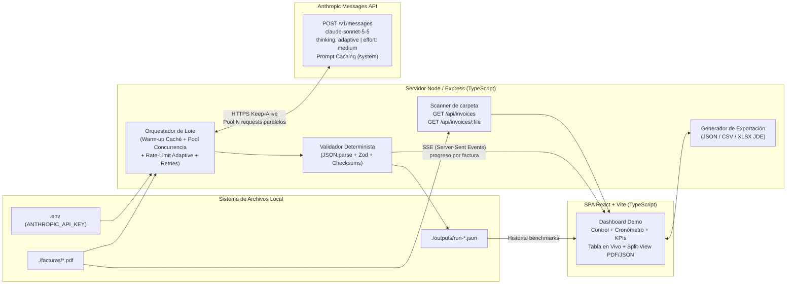

# Plan de Implementación — Demo de Extracción Ultrarrápida de Facturas (Gases del Caribe → JD Edwards)

> **Propósito:** Plan técnico y funcional completo para construir un demo en **React** capaz de extraer, reconciliar y exportar en el menor tiempo posible los datos contables de `N` facturas PDF de **Gases del Caribe S.A. E.S.P.** alojadas en una carpeta local del proyecto, utilizando la API de **Anthropic (`claude-sonnet-5-5`)**.

---

## 1. Resumen Ejecutivo y Decisiones de Diseño

| Dimensión | Decisión Acordada |
| :--- | :--- |
| **Fuente de facturas** | Carpeta local incluida en el proyecto (`./facturas/`), con **1 archivo PDF de 1 página por factura** (ej. `factura_01.pdf`). |
| **Volumen objetivo** | Lote típico de demo de **10 a 50 facturas** por ejecución, con arquitectura escalable y configurable para cualquier `N`. |
| **Arquitectura** | **React + Vite (TypeScript)** + **servidor Node/Express ligero** (en el mismo repositorio, arranque único) + streaming en tiempo real vía **SSE (Server-Sent Events)**. |
| **Envío de documentos** | Envío nativo de cada PDF en base64 mediante bloque `type: "document"` (`media_type: "application/pdf"`), con precarga paralela desde disco y validación de tamaño máximo (sin dependencias de renderizado). |
| **Modelo e inferencia** | `claude-sonnet-5-5` · `anthropic-version: 2023-06-01` · `max_tokens: 6000` · `thinking: { type: "adaptive" }` · `output_config: { effort: "medium" }` · **Prompt Caching** (`ephemeral`) en `system`. |
| **Validación y reintentos** | Validación determinista local (**Zod** + verificación matemática independiente en TypeScript). Reintento automático (máx. 2 intentos con backoff exponencial) **solo** ante errores de red, HTTP `429`/`529` o JSON malformado. **Sin reintentos por `cuadra: false`** para reflejar la precisión real en una sola pasada. |
| **Interfaz (UI)** | Dashboard completo de demo: panel de control (selección total/parcial, slider de concurrencia, warm-up de caché, iniciar/cancelar), KPIs en vivo, tabla reactiva por factura y **visor lateral split-view** (PDF original vs datos extraídos + JSON). |
| **Exportación y benchmarks** | Descarga de **JSON consolidado** y **Excel (`.xlsx`) / CSV orientado a JD Edwards** con 2 vistas/hojas (*Resumen por factura* y *Detalle contable por concepto*). Historial de corridas guardado automáticamente en `./outputs/` para comparar benchmarks. |
| **Seguridad de credenciales** | La API Key de Anthropic se almacena exclusivamente en `.env` (`ANTHROPIC_API_KEY`), excluido del control de versiones vía `.gitignore`. Nunca se expone al navegador ni se commitea en código o documentación. |

---

## 2. Arquitectura del Sistema

### 2.1 Diagrama de Flujo de Datos



### 2.2 Por qué React + Vite con Servidor Node/Express Ligero

1. **Sin cuello de botella de navegador:** Los navegadores restringen conexiones paralelas por origen y exponen headers/secretos en DevTools. Desde Node.js se maneja libremente un pool de `1..20+` solicitudes concurrentes con `keep-alive`.
2. **Lectura dinámica real de `./facturas/`:** El usuario puede agregar, quitar o reemplazar PDFs en la carpeta y hacer clic en *"Recargar carpeta"* sin recompilar React.
3. **Visibilidad de headers de Anthropic:** El servidor lee `anthropic-ratelimit-requests-remaining`, `anthropic-ratelimit-input-tokens-remaining` y `retry-after` para adaptar la cadencia y evitar cascadas de errores `429`.
4. **Seguridad del API Key:** La clave nunca viaja al cliente ni aparece en el bundle de Vite.

---

## 3. Estructura de Directorios Propuesta

```text
DemoExtraccion/
├── .env                          # NO commitear (contiene ANTHROPIC_API_KEY)
├── .env.example                  # Plantilla de variables de entorno
├── .gitignore                    # Ignora .env, node_modules, dist, outputs/*.json
├── package.json                  # Scripts unificados (dev, build, start)
├── tsconfig.json
├── vite.config.ts                # Proxy /api -> servidor Express local
├── facturas/                     # Carpeta de entrada con PDFs (1 página = 1 factura)
│   └── README.md                 # Instrucciones para colocar las facturas de prueba
├── outputs/                      # Historial de benchmarks (run-YYYYMMDD-HHmmss.json)
├── shared/                       # Tipos compartidos Frontend <-> Backend
│   ├── schema.ts                 # Esquema Zod estricto del JSON de factura
│   └── types.ts                  # Tipos de Job, SSE events, métricas y benchmark
├── server/                       # Backend Node + Express (TypeScript)
│   ├── index.ts                  # Bootstrap Express + rutas REST/SSE
│   ├── config.ts                 # Carga segura de .env y defaults de ejecución
│   ├── prompt.ts                 # System prompt exacto (ver Sección 9)
│   ├── services/
│   │   ├── invoiceScanner.ts     # Listado, ordenamiento y precarga paralela de PDFs
│   │   ├── anthropicClient.ts    # Llamada directa a /v1/messages + parsing de usage/headers
│   │   ├── batchOrchestrator.ts  # Pool de concurrencia, warm-up caché, retries, AbortController
│   │   ├── deterministicValidator.ts # Validación Zod + recalculo contable independiente
│   │   ├── runStore.ts           # Lectura/escritura de corridas en ./outputs/
│   │   └── jdeExporter.ts        # Generación de CSV y XLSX (Resumen + Detalle JDE)
│   └── routes/
│       ├── invoices.ts           # GET /api/invoices, GET /api/invoices/:name/pdf
│       ├── runs.ts               # POST /api/runs, GET /api/runs/:id/stream (SSE), DELETE cancel, historial
│       └── export.ts             # GET /api/runs/:id/export?format=json|xlsx|csv-summary|csv-detail
└── src/                          # Frontend React + Vite + Tailwind CSS
    ├── main.tsx
    ├── App.tsx
    ├── hooks/
    │   ├── useInvoices.ts        # Carga y selección de PDFs de ./facturas/
    │   ├── useExtractionRun.ts   # Conexión SSE, cronómetro en vivo y estado por factura
    │   └── useBenchmarkHistory.ts# Comparativa entre ejecuciones guardadas
    ├── components/
    │   ├── ControlBar.tsx        # Selector de facturas, concurrencia, warm-up, iniciar/cancelar
    │   ├── KpiStrip.tsx          # Cronómetro total, throughput, % cuadre, latencia, costo/tokens
    │   ├── InvoiceTable.tsx      # Tabla reactiva en tiempo real con filtros y totales JDE
    │   ├── SplitViewDrawer.tsx   # Panel lateral: visor PDF original + vista contable + JSON crudo
    │   ├── BenchmarkDrawer.tsx   # Comparador de ejecuciones guardadas en ./outputs/
    │   └── ExportMenu.tsx        # Botones de descarga JSON / XLSX / CSV (Resumen y Detalle)
    └── utils/
        └── formatters.ts         # Formato COP ($), tiempos (ms/s), cálculo de costo estimado
```

---

## 4. Integración con Anthropic API y Estrategia de Máxima Velocidad

### 4.1 Contrato de Petición a Anthropic (`/v1/messages`)

Cada factura se envía con la siguiente estructura exacta:

- **Endpoint:** `POST https://api.anthropic.com/v1/messages`
- **Headers:**
  - `Content-Type: application/json`
  - `x-api-key: ${process.env.ANTHROPIC_API_KEY}`
  - `anthropic-version: 2023-06-01`
- **Body:**

```json
{
  "model": "claude-sonnet-5-5",
  "max_tokens": 6000,
  "thinking": {
    "type": "adaptive"
  },
  "output_config": {
    "effort": "medium"
  },
  "system": [
    {
      "type": "text",
      "text": "<PROMPT_SISTEMA_EXACTO_SECCION_9>",
      "cache_control": {
        "type": "ephemeral"
      }
    }
  ],
  "messages": [
    {
      "role": "user",
      "content": [
        {
          "type": "document",
          "source": {
            "type": "base64",
            "media_type": "application/pdf",
            "data": "<BASE64_DEL_PDF>"
          }
        },
        {
          "type": "text",
          "text": "Extrae los datos de esta factura siguiendo estrictamente el contrato de salida JSON."
        }
      ]
    }
  ]
}
```

> **Nota de implementación en el parsing de respuesta:** Cuando `thinking.type = "adaptive"` está activo, el array `response.content` puede contener bloques `{ type: "thinking", ... }` seguidos del bloque `{ type: "text", text: "{...}" }`. El cliente debe extraer específicamente el bloque `type === "text"` (ignorando bloques `thinking`) antes de ejecutar `JSON.parse()`.

### 4.2 Palancas de Optimización de Velocidad ("En el menor tiempo posible")

1. **Precarga Paralela de Archivos (Zero Disk I/O Wait):**
   - Al iniciar el lote, el servidor lee en paralelo (`Promise.all` con límite de descriptores) los `N` PDFs desde `./facturas/`, valida que sean PDFs válidos (`%PDF-`) y menores al límite de Anthropic (ej. alerta si > 10 MB; límite API 32 MB), y los mantiene en buffers base64 listos para despachar sin bloquear el event loop.
2. **Pool de Concurrencia Dinámico (Worker Pool):**
   - Cola asíncrona con `K` workers paralelos (configurable desde la UI de `1` a `20`, valor recomendado inicial: `8` o `10` según el tier de rate-limit de la cuenta).
   - Uso de `undici` / HTTP Keep-Alive persistente para evitar handshakes TLS repetidos.
   - **Throttling reactivo por headers:** Tras cada respuesta se inspeccionan `anthropic-ratelimit-requests-remaining` y `anthropic-ratelimit-input-tokens-remaining`; si el margen cae cerca de cero, los workers aplican una pausa corta coordinada para evitar colisiones `429`.
3. **Prompt Caching + Estrategia de Warm-Up Configurable:**
   - El system prompt de Gases del Caribe es extenso (~2,000+ tokens) e idéntico para las `N` facturas.
   - **Modo *Warm-Up activado* (recomendado para `N >= 10`):** El orquestador despacha la factura `#1` primero y, en cuanto recibe la respuesta inicial (o tras ~2–3s si se hace staggered launch), dispara las `N-1` restantes a máxima concurrencia. Esto garantiza que las facturas `2..N` consuman `cache_read_input_tokens`, reduciendo drásticamente el consumo de cuota ITPM (Input Tokens Per Minute), la latencia TTFT y hasta ~90% del costo de tokens del prompt.
   - **Modo *Paralelo inmediato* (`t=0`):** Toggle disponible en la UI para comparar en vivo si para lotes pequeños (`N <= 10`) conviene disparar todo desde el milisegundo 0.
4. **Presupuesto de Tokens Ajustado (`max_tokens: 6000`):**
   - Suficiente para el razonamiento adaptativo en `effort: "medium"` más la salida JSON (~500–900 tokens), evitando truncamientos (`stop_reason === "max_tokens"`).
5. **Streaming de Progreso por SSE (`text/event-stream`):**
   - Cada transición de estado (`queued` → `processing` → `retrying` → `completed` / `failed`) se emite inmediatamente al frontend. El usuario ve resultados aparecer factura por factura desde los primeros segundos, sin esperar al final del lote.
6. **Cancelación Inmediata (`AbortController`):**
   - Cada solicitud en vuelo está ligada al `AbortController` de la corrida para detener el lote al instante sin desperdiciar créditos si se cancela el demo.

---

## 5. Validación Determinista Local y Política de Reintentos

### 5.1 Pipeline de Validación por Factura (Post-API)

Una vez recibido el bloque de texto de Anthropic, el servidor ejecuta 3 capas deterministas en TypeScript **antes** de emitir el resultado al cliente:

1. **Capa 1 — Integridad de Contrato JSON:**
   - Verifica que el primer carácter sea `{` y el último `}` (`strictContractPass: boolean`).
   - Intenta `JSON.parse()` directo. Si falla por delimitadores accidentales (ej. ```` ```json ````), registra la advertencia en métricas pero intenta limpieza de emergencia; si sigue sin ser JSON válido o `stop_reason === "max_tokens"`, dispara reintento técnico.
2. **Capa 2 — Validación de Esquema (Zod):**
   - Valida estrictamente todas las claves de `<esquema_json>`:
     - `identificacion`: 8 campos (`string | null`, `estrato: integer | null`).
     - `fechas`: 5 campos (`YYYY-MM-DD` o texto de período / `null`).
     - `conceptos_extraidos`: array de `{ nombre_en_documento, componente: "UNICO", valor: integer, cuenta_asignada: "513555.35" | "519595.05" | "519595.30" }`.
     - `totales_por_cuenta`: exactamente las 3 llaves `"513555.35"`, `"519595.05"`, `"519595.30"` (enteros).
     - Escalares: `saldo_anterior`, `cargos_del_mes`, `valor_total`, `valor_brilla`, `consumo_actual`, `consumo_anterior`, `pago_total_anterior`.
     - `observaciones: string[]` y `validacion: { suma_conceptos, total_impreso, cuadra }`.
   - Prohibición estricta de llaves adicionales (`.strict()`).
3. **Capa 3 — Reconciliación Matemática Independiente (Auditoría en Código):**
   - El backend recalcula desde cero:
     - `calcSumaConceptos = sum(conceptos_extraidos.map(c => c.valor))`
     - `calcTotalesCuenta` agrupando por `cuenta_asignada`
     - `calcSumaCuentas = calcTotalesCuenta["513555.35"] + calcTotalesCuenta["519595.05"] + calcTotalesCuenta["519595.30"]`
     - `cuadreCuentasOk = (calcSumaCuentas === calcSumaConceptos) && igualdad exacta con totales_por_cuenta del modelo`
     - `cuadreTotalOk = (calcSumaConceptos + (saldo_anterior ?? 0) === valor_total) || (calcSumaConceptos === valor_total)`
   - Clasifica el resultado final de la factura en uno de 4 estados visibles en la UI:
     - **`CUADRA` (Verde):** Factura válida, `validacion.cuadra === true` y auditoría matemática local 100% consistente.
     - **`DESCUADRE` (Ámbar):** Factura válida donde `validacion.cuadra === false` **o** existe discrepancia entre el reporte del modelo y la auditoría local (se muestra el detalle exacto de la diferencia en pesos).
     - **`NO_VALIDA` (Gris/Azul):** Documento no correspondiente a Gases del Caribe (carátula, separador, blanco, etc.) correctamente detectado según `<documentos_no_validos>`.
     - **`ERROR` (Rojo):** Fallo irrecuperable de API, timeout o JSON inválido tras agotar reintentos.

### 5.2 Política de Reintentos (Transparencia del Demo)

| Tipo de fallo | ¿Reintenta? | Regla |
| :--- | :---: | :--- |
| HTTP `429` (Rate Limit) o `529` (Overloaded) | Sí | Hasta **2 reintentos** respetando `retry-after` (o backoff exponencial `1.5s`, `4s` + jitter). |
| Error de red / timeout (> 60s) / HTTP `5xx` | Sí | Hasta **2 reintentos** con backoff exponencial + jitter. |
| JSON no parseable o respuesta truncada (`max_tokens`) | Sí | Hasta **2 reintentos** (se registra `attempts > 1` en la tabla). |
| `cuadra: false` o diferencia matemática | **No** | **No se reintenta** para mostrar fielmente la precisión real en una sola pasada de `claude-sonnet-5-5`. |
| Documento no válido (`NO_VALIDA`) | **No** | Es un resultado esperado del contrato. |

---

## 6. Diseño de Interfaz de Usuario (React)

Estética propuesta: diseño limpio, técnico-financiero de alto contraste (Tailwind CSS + Lucide Icons), optimizado para proyección en vivo durante demos ejecutivas.

### 6.1 Distribución de Pantalla

1. **Header y Barra de Control (`ControlBar`):**
   - Ruta/estado de carpeta (`./facturas/` — ej. *"32 archivos PDF detectados"*) + botón **Refrescar carpeta**.
   - Selector de alcance: **Todas (`N`)** o **Subconjunto rápido** (ej. `5`, `10`, `20`, o selección manual por checkboxes).
   - **Slider de concurrencia** (`1` a `20`, default `8`).
   - **Toggle "Warm-up de caché"** (Activado por defecto para lotes `>= 10`).
   - Botón principal **Iniciar Extracción** (cambia a **Cancelar** mientras corre) + botón **Historial / Benchmarks** + menú **Exportar**.

2. **Franja de KPIs en Vivo (`KpiStrip`):**
   - **Cronómetro Total:** reloj en tiempo real (`00:14.8 s`) que se detiene automáticamente al finalizar la última factura.
   - **Progreso y Velocidad:** `24 / 30` (barra de progreso) · throughput (`facturas/seg`) · latencia media y `p95` por factura.
   - **Exactitud Contable:** contadores de `Cuadran` (`%`), `Descuadran`, `No válidas` y `Errores`.
   - **Consumo y Caché:** tokens de entrada / salida, `% Cache Hit` (`cache_read_input_tokens`) y **costo estimado USD** de la corrida.

3. **Tabla Reactiva de Facturas (`InvoiceTable`):**
   - Filtros rápidos por estado (`Todas`, `Cuadran`, `Descuadran`, `No válidas`, `Error`) y buscador por archivo, N° factura, contrato o titular.
   - Columnas principales:
     - Estado (badge animado mientras procesa)
     - Archivo PDF
     - Tiempo (s) + intentos
     - N° Factura / Contrato
     - Titular / Estrato
     - Cuenta `513555.35` (Gas / Cargo Fijo / Consumo)
     - Cuenta `519595.05` (Financiación / Mora / Reconexión)
     - Cuenta `519595.30` (Equipo Medidor)
     - Total a Pagar (`valor_total`)
     - Validación (Modelo vs Auditoría Local)
   - Fila de **Totales Consolidados** al pie de la tabla (suma de las 3 cuentas JDE y total general de las facturas válidas).

4. **Visor Lateral Split-View (`SplitViewDrawer`):**
   - Se abre al hacer clic en cualquier fila de la tabla.
   - **Mitad izquierda:** Visor embebido del PDF original (`<iframe>` / `<object>` hacia `GET /api/invoices/:filename/pdf`) con zoom nativo del navegador para inspección visual instantánea.
   - **Mitad derecha (con 2 pestañas):**
     - *Vista Contable JDE:* tarjetas de Identificación, Fechas, Consumo, tabla de `conceptos_extraidos` con su `cuenta_asignada`, desglose de `totales_por_cuenta`, alerta de verificación matemática (checksum local vs modelo) y lista de `observaciones`.
     - *JSON Crudo:* bloque JSON formateado exactamente como lo emitió el modelo + botón **Copiar JSON** + metadatos de latencia y tokens de esa factura.

5. **Comparador de Benchmarks (`BenchmarkDrawer`):**
   - Lista de ejecuciones guardadas en `./outputs/` mostrando fecha/hora, `N` facturas, concurrencia, warm-up on/off, tiempo total, facturas/seg, `% cuadre` y costo estimado, permitiendo cargar cualquier corrida anterior en la tabla principal para inspección o exportación.

---

## 7. Contratos de API Local y Exportación JD Edwards

### 7.1 Endpoints del Backend Local

| Método | Ruta | Descripción |
| :--- | :--- | :--- |
| `GET` | `/api/invoices` | Escanea `./facturas/` y retorna lista ordenada de PDFs (`filename`, `sizeBytes`, `modifiedAt`). |
| `GET` | `/api/invoices/:filename/pdf` | Sirve el archivo PDF original (con protección anti path-traversal) para el Split-View. |
| `POST` | `/api/runs` | Inicia una corrida de extracción. Body: `{ files?: string[], concurrency: number, cacheWarmup: boolean }`. Retorna `{ runId, totalFiles }`. |
| `GET` | `/api/runs/:runId/stream` | Canal **SSE** que emite eventos: `run:started`, `invoice:processing`, `invoice:retrying`, `invoice:done`, `invoice:error`, `run:completed`, `run:cancelled`. |
| `POST` | `/api/runs/:runId/cancel` | Activa el `AbortController` de la corrida en curso. |
| `GET` | `/api/runs` | Lista el historial de corridas guardadas en `./outputs/` (resúmenes de benchmark). |
| `GET` | `/api/runs/:runId` | Carga el resultado completo de una corrida histórica desde `./outputs/`. |
| `GET` | `/api/runs/:runId/export` | Descarga resultados según `?format=json | xlsx | csv-summary | csv-detail`. |

### 7.2 Formatos de Exportación (Orientados a JD Edwards)

1. **JSON Consolidado (`run-<id>.json`):**
   - Incluye `metadata` (modelo, parámetros, concurrencia, warm-up, duración total ms, tokens totales, costo estimado) + array `results` (archivo, estado, latencia ms, intentos, `data` con el esquema JSON exacto y `localAudit`).
2. **Excel Multi-Hoja (`.xlsx`) y CSVs Separados:**
   - **Hoja 1 — `Resumen_Facturas` (1 fila por factura):**
     - `archivo`, `estado_validacion`, `cuadra_modelo`, `cuadra_auditoria`, `tiempo_ms`, `numero_factura`, `numero_contrato`, `numero_cupon`, `numero_medidor`, `titular`, `direccion_predio`, `apto`, `estrato`, `periodo_facturacion_actual`, `fecha_emision`, `primer_vencimiento`, `segundo_vencimiento`, `consumo_actual`, `consumo_anterior`, `saldo_anterior`, `cargos_del_mes`, `cta_513555_35`, `cta_519595_05`, `cta_519595_30`, `valor_total`, `valor_brilla`, `pago_total_anterior`, `observaciones`.
   - **Hoja 2 — `Detalle_Conceptos_JDE` (1 fila por concepto extraído):**
     - `archivo`, `numero_factura`, `numero_contrato`, `fecha_emision`, `primer_vencimiento`, `titular`, `cuenta_asignada`, `nombre_en_documento`, `componente`, `valor`, `cuadra_auditoria`.

---

## 8. Plan de Trabajo por Fases y Verificación

### Fase 1 — Cimientos del Proyecto y Configuración Segura
- Inicializar proyecto **Vite + React + TypeScript + Tailwind CSS** y configurar servidor **Express + tsx** con arranque unificado (`npm run dev` usando `concurrently`).
- Crear `.env.example`, `.gitignore` (excluyendo `.env` y `outputs/*.json`), carpetas `./facturas/` y `./outputs/`.
- Configurar localmente `.env` con `ANTHROPIC_API_KEY` (sin exponerla en código ni repositorio).
- Definir `shared/schema.ts` (Zod estricto para `<esquema_json>`) y `shared/types.ts`.

### Fase 2 — Motor de Extracción de Alta Velocidad (Backend)
- Implementar `server/prompt.ts` con el prompt exacto de la Sección 9.
- Implementar `invoiceScanner.ts` (escaneo de `./facturas/`, validación de encabezado `%PDF-`, precarga paralela en base64).
- Implementar `anthropicClient.ts` con la configuración exacta (`claude-sonnet-5-5`, `max_tokens: 6000`, `thinking: { type: "adaptive" }`, `output_config: { effort: "medium" }`, Prompt Caching `ephemeral`, extracción del bloque `text` y captura de `usage` + headers `anthropic-ratelimit-*`).
- Implementar `deterministicValidator.ts` (validación de contrato JSON, Zod y reconciliación aritmética independiente).
- Implementar `batchOrchestrator.ts` (warm-up de caché opcional, worker pool configurable, throttling adaptativo, reintentos solo para errores técnicos, `AbortController`, emisión SSE y persistencia en `./outputs/`).
- Implementar `jdeExporter.ts` (exportación JSON, `.xlsx` con 2 hojas y CSVs con BOM UTF-8 para compatibilidad directa con Excel en español).

### Fase 3 — Dashboard React de Demo en Tiempo Real
- Construir `ControlBar` y `useInvoices` (lista de PDFs, selección parcial/total, concurrencia, warm-up, iniciar/cancelar).
- Construir `useExtractionRun` (cliente `EventSource` SSE + cronómetro de alta precisión `requestAnimationFrame` / `performance.now()`).
- Construir `KpiStrip` con métricas en vivo (tiempo total, facturas/seg, promedio, `% cuadre`, `% cache hit`, costo estimado).
- Construir `InvoiceTable` con estados en tiempo real, filtros, búsqueda y fila consolidada de totales JDE.
- Construir `SplitViewDrawer` (PDF original + vista contable estructurada + pestaña JSON crudo) y `BenchmarkDrawer` (historial y comparativa de corridas).
- Conectar `ExportMenu` para descargas instantáneas.

### Fase 4 — Benchmarking, Ajuste de Velocidad y Pruebas de Aceptación
- **Prueba funcional (3–5 facturas + 1 PDF no válido):** verificar que las válidas retornen `CUADRA`, la no válida retorne `NO_VALIDA` cumpliendo `<documentos_no_validos>`, y el Split-View muestre correctamente PDF vs JSON.
- **Prueba de velocidad y concurrencia (lote de 10–50 facturas):** ejecutar benchmarks comparando concurrencia (`5` vs `10` vs `15`) y warm-up (`ON` vs `OFF`) guardando resultados en `./outputs/` para identificar el punto óptimo sin disparos excesivos de `429`.
- **Prueba de exportación JD Edwards:** abrir el `.xlsx` y los CSVs en Excel verificando tildes/eñes, enteros limpios, signos negativos en subsidios y cuadre entre `Resumen_Facturas` y `Detalle_Conceptos_JDE`.
- **Prueba de cancelación:** cancelar una corrida a mitad de ejecución y validar que cesan las peticiones salientes y la UI queda en estado consistente.

### Riesgos Conocidos y Mitigaciones
- **Límites de tasa (RPM / ITPM) de Anthropic:** Mitigado con Prompt Caching (reduce ITPM en facturas `2..N`), slider de concurrencia en UI, lectura de headers `anthropic-ratelimit-*` y backoff exponencial con `retry-after`.
- **PDFs escaneados de gran peso:** Se valida el tamaño antes de enviar y se muestra el peso de cada PDF en el selector para identificar archivos anómalos.
- **Seguridad de la API Key:** Dado que la clave se compartió durante la fase de planificación, se recomienda **rotar la API Key en la consola de Anthropic** antes de pasar a un entorno compartido o productivo, y almacenarla únicamente en el archivo local `.env`.

---

## 9. Prompt Determinista Exacto (System Prompt Inmutable)

El siguiente texto debe cargarse **literalmente sin modificaciones** en `server/prompt.ts` dentro del campo `system` con `cache_control: { type: "ephemeral" }`:

```text
<rol>
Eres un motor determinista de extracción de datos para facturas de gas natural (Gases del Caribe S.A. E.S.P., Colombia) con destino a contabilización automática en JD Edwards.
</rol>

<contrato_de_salida>
REGLA ABSOLUTA DE FORMATO:
- Tu respuesta debe ser ÚNICAMENTE un objeto JSON válido, parseable directamente por JSON.parse().
- El primer carácter de tu respuesta DEBE ser `{` y el último carácter DEBE ser `}`.
- PROHIBIDO incluir saludos, advertencias, notas de cálculo, explicaciones, preguntas o texto antes o después del JSON, incluso si el documento NO es una factura válida.
- PROHIBIDO envolver el JSON en bloques de código Markdown (no uses ```json ni ```).
- PROHIBIDO agregar, renombrar o eliminar claves del esquema definido en <esquema_json>.
- Ejecuta internamente todas las verificaciones de columnas, sumas horizontales dígito a dígito y reconciliaciones ANTES de emitir el primer carácter `{`, sin imprimir borradores fuera del objeto.
</contrato_de_salida>

<documentos_no_validos>
Si el archivo adjunto NO corresponde a una factura de Gases del Caribe (por ejemplo: carátulas, separadores de lote, hojas manuscritas, páginas en blanco, recibos de otra empresa o imágenes ilegibles):
- NUNCA respondas con texto conversacional fuera del JSON.
- Devuelve obligatoriamente el mismo objeto JSON con:
  - Todos los campos de `identificacion` y `fechas` en `null`.
  - `conceptos_extraidos`: `[]`.
  - `totales_por_cuenta`: todas las cuentas en `0`.
  - `saldo_anterior`, `cargos_del_mes`, `valor_total`, `valor_brilla`, `consumo_actual`, `consumo_anterior`, `pago_total_anterior` en `null`.
  - `validacion`: `{"suma_conceptos": 0, "total_impreso": null, "cuadra": false}`.
  - `observaciones`: incluir el motivo concreto (ej. "El documento es una carátula/separador de lote y no contiene una factura de Gases del Caribe.").
</documentos_no_validos>

<principio_general>
Prioriza EXACTITUD sobre completitud. NUNCA inventes, estimes ni infieras datos; si un campo falta o no está impreso explícitamente en el documento, usa null.
</principio_general>

<reglas_formato_datos>
- Fechas: formato AAAA-MM-DD (ej. "2026-10-27").
- Montos monetarios: números enteros sin símbolos de moneda, sin puntos ni comas de miles y sin decimales (ej. "$47.689" -> 47689, "$ 8,707" -> 8707).
- Valores negativos / subsidios: conservar obligatoriamente el signo negativo como entero (ej. -12500).
- Consumo: número entero o decimal limpio.
</reglas_formato_datos>

<mapeo_campos>
- Recuadro verde ("DATOS DEL CONTRATO"):
  - numero_contrato: N° de contrato.
  - numero_cupon: Cupón para pago.
  - primer_vencimiento: Fecha límite de pago (AAAA-MM-DD).
  - valor_total: Total a pagar.
- Recuadro azul:
  - numero_factura: Número de factura en el título (ej. "GCFR...").
  - fecha_emision: Fecha de emisión (AAAA-MM-DD).
  - periodo_facturacion_actual: Período de factura.
  - periodo_facturacion_anterior: ÚNICAMENTE si está impreso explícitamente como texto de período anterior; de lo contrario, `null`.
- Bloques centrales:
  - titular: Nombre del cliente/suscriptor.
  - direccion_predio: Dirección del predio exactamente como está impresa (sin agregar ni quitar espacios alrededor de guiones).
  - numero_medidor: Serial alfanumérico con guiones (ej. "K-5064607-24" o "SH-21077587-24").
  - apto: ÚNICAMENTE el número/identificador limpio del apartamento extraído de la dirección (sin prefijos como "AP", "APTO", "TO" ni el número de torre; si no aplica, null).
  - estrato: Estrato numérico (entero).
- Bloque "DATOS DE CONSUMO":
  - consumo_actual: Valor impreso en "Consumo mes (m³)".
  - consumo_anterior: ÚNICAMENTE si existe un valor numérico explícito para el consumo del mes anterior (por ejemplo, etiqueta numérica impresa sobre la barra del mes previo). NUNCA uses "Lectura anterior (m³)" ni "Promedio m³" como `consumo_anterior`; si no está impreso explícitamente, usa `null`.
- Franja inferior y resumen de pago:
  - segundo_vencimiento: "Fecha susp. por mora desde" (AAAA-MM-DD).
  - saldo_anterior: valor impreso en la casilla "Saldo anterior" (`0` si está vacía o en blanco en una factura válida).
  - cargos_del_mes: valor impreso en la casilla "Cargos del mes".
  - pago_total_anterior: "Valor del último pago".
  - Meses de deuda: registrar únicamente dentro de `observaciones` si existe.
- Programa Brilla (`valor_brilla`):
  - Si "Cupo disponible" es texto o enlace web, registrar `null`.
  - Si es un valor numérico, registrarlo como entero en `valor_brilla` y NUNCA sumarlo a las cuentas de gas.
</mapeo_campos>

<conceptos_y_cuentas>
Reglas estrictas de lectura de la tabla de conceptos:
- Trabaja ÚNICAMENTE con las tres columnas bajo el encabezado `CARGOS DEL MES`: `Capital`, `Intereses` e `IVA 19%`. Si una celda está vacía, su valor es `0`.
- IGNORA estrictamente las columnas `Valor unitario`, `Cant. item` y el bloque `PENDIENTES` (`Saldo` / `Cuotas`). Tampoco uses `Total factura electrónica` (suele excluir capital financiado).
- Para cada renglón facturado, calcula `valor = Capital + Intereses + IVA 19%` verificando la suma posición por posición (unidades, decenas, centenas y miles) con especial rigor en los acarreos cuando un mismo renglón tenga montos distintos de `0` en dos o más columnas (ej. `2703 + 607`: unidades `3+7=10` [0, llevo 1], decenas `0+0+1=1`, centenas `7+6=13` [3, llevo 1], miles `2+1=3` -> `3310`).
- Cada renglón impreso facturado = un objeto independiente en `conceptos_extraidos` con `"componente": "UNICO"`. No fusiones renglones aunque compartan la misma cuenta contable.
- Ignora encabezados de grupo como "SERV.GAS (...)" y filas de totales (`Total Servicio`, `TOTAL SERVICIOS`).

Asignación de cuentas contables obligatoria:
- "513555.35": Cargo fijo (17), Consumo (31), Instalación del servicio (281, capital e intereses), Modificación centro medición (281), Subsidios (negativos), Saldo anterior.
- "519595.05": Financiaciones (761 o sin código), Intereses de financiación (283), Reconexiones (131), Recargos/Intereses de mora (284, 156), Sanciones.
- "519595.30": EXCLUSIVA si se cobra la compra o instalación del equipo medidor (no modificaciones).
</conceptos_y_cuentas>

<protocolo_reconciliacion_obligatoria>
ANTES de escribir el primer carácter `{` del JSON final, ejecuta y cierra internamente estas 4 comprobaciones de cuadre (checksums) usando la fila impresa `TOTAL SERVICIOS` (o `Total Servicio`):
1. Cuadre vertical por columna:
   - `suma(Capital de todos los renglones) == Total Capital impreso en TOTAL SERVICIOS`.
   - `suma(Intereses de todos los renglones) == Total Intereses impreso en TOTAL SERVICIOS`.
   - `suma(IVA de todos los renglones) == Total IVA impreso en TOTAL SERVICIOS`.
2. Cuadre horizontal y de cargos del mes (doble vía):
   - Vía A (por totales de columna): `Total Capital + Total Intereses + Total IVA == cargos_del_mes impreso`.
   - Vía B (por suma de renglones): `suma(valor de todos los conceptos_extraidos) == Total Capital + Total Intereses + Total IVA`.
   - REGLA CRÍTICA: Si la Vía A cuadra con `cargos_del_mes` pero la Vía B NO coincide con la Vía A, la lectura de los dígitos es correcta y el error es **100% un fallo de suma horizontal (`Capital + Intereses + IVA`) en alguno de los renglones** (revisa primero los renglones que tienen valores en más de una columna y repite la suma columna por columna: unidades, decenas, centenas, miles).
3. Cuadre por cuenta contable:
   - Suma por separado los `valor` de cada cuenta en `totales_por_cuenta` verificando los acarreos.
   - Comprueba que `totales_por_cuenta["513555.35"] + totales_por_cuenta["519595.05"] + totales_por_cuenta["519595.30"] == suma_conceptos`.
   - Comprueba que `(suma_conceptos + saldo_anterior) == valor_total` (o `suma_conceptos == valor_total` si el saldo anterior ya está en `conceptos_extraidos`).
4. Autocorrección obligatoria ante cualquier diferencia (incluso de 1 o 10 pesos):
   - Si falla la comprobación 1: identifica la columna (`Capital`, `Intereses` o `IVA`) que no cuadra con `TOTAL SERVICIOS` y re-inspecciona los dígitos impresos (prestando atención a `0/1/6/8/9`).
   - Si falla la comprobación 2 (Vía B) o la 3: recalcula de cero las sumas horizontales de cada concepto y las sumas por cuenta hasta que todas las vías coincidan exactamente.
   - NUNCA marques `"cuadra": false` por un error de aritmética propio; solo usa `"cuadra": false` si tras verificar vertical y horizontalmente el documento original tiene un error de impresión real, explicando la diferencia exacta en `observaciones`.
</protocolo_reconciliacion_obligatoria>

<validacion_matematica>
- totales_por_cuenta: suma algebraica exacta (respetando signos negativos) de `valor` agrupada por `cuenta_asignada`. Mantener siempre las tres cuentas presentes (con `0` si no tienen movimientos).
- cargos_del_mes: valor de Cargos del Mes (`Total Capital + Total Intereses + Total IVA`).
- saldo_anterior: valor del saldo anterior impreso (`0` si no hay saldo anterior en una factura válida).
- valor_total: Total a Pagar impreso en la factura (`saldo_anterior + cargos_del_mes`).
- suma_conceptos: suma algebraica de todos los `valor` en `conceptos_extraidos`.
- total_impreso: valor de Total a Pagar impreso en la factura.
- cuadra: `true` si y solo si la factura es válida, `totales_por_cuenta["513555.35"] + totales_por_cuenta["519595.05"] + totales_por_cuenta["519595.30"] == suma_conceptos`, y `(suma_conceptos + saldo_anterior) == valor_total` (o `suma_conceptos == valor_total` cuando el saldo anterior ya está incluido como renglón en `conceptos_extraidos`); de lo contrario `false`.
</validacion_matematica>

<esquema_json>
{
  "identificacion": {
    "numero_factura": "string | null",
    "numero_contrato": "string | null",
    "numero_cupon": "string | null",
    "numero_medidor": "string | null",
    "titular": "string | null",
    "direccion_predio": "string | null",
    "apto": "string | null",
    "estrato": "integer | null"
  },
  "fechas": {
    "periodo_facturacion_actual": "string | null",
    "periodo_facturacion_anterior": "string | null",
    "fecha_emision": "string | null",
    "primer_vencimiento": "string | null",
    "segundo_vencimiento": "string | null"
  },
  "conceptos_extraidos": [
    {
      "nombre_en_documento": "string",
      "componente": "UNICO",
      "valor": "integer",
      "cuenta_asignada": "513555.35 | 519595.05 | 519595.30"
    }
  ],
  "totales_por_cuenta": {
    "513555.35": "integer",
    "519595.05": "integer",
    "519595.30": "integer"
  },
  "saldo_anterior": "integer | null",
  "cargos_del_mes": "integer | null",
  "valor_total": "integer | null",
  "valor_brilla": "integer | null",
  "consumo_actual": "number | null",
  "consumo_anterior": "number | null",
  "pago_total_anterior": "integer | null",
  "observaciones": ["string"],
  "validacion": {
    "suma_conceptos": "integer",
    "total_impreso": "integer | null",
    "cuadra": "boolean"
  }
}
</esquema_json>

<verificacion_final>
Emite exclusivamente el objeto JSON crudo empezando con `{` y terminando con `}`, sin texto explicativo previo ni posterior y sin delimitadores Markdown, incluso si el documento no es una factura.
</verificacion_final>
```
